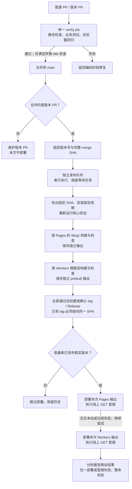
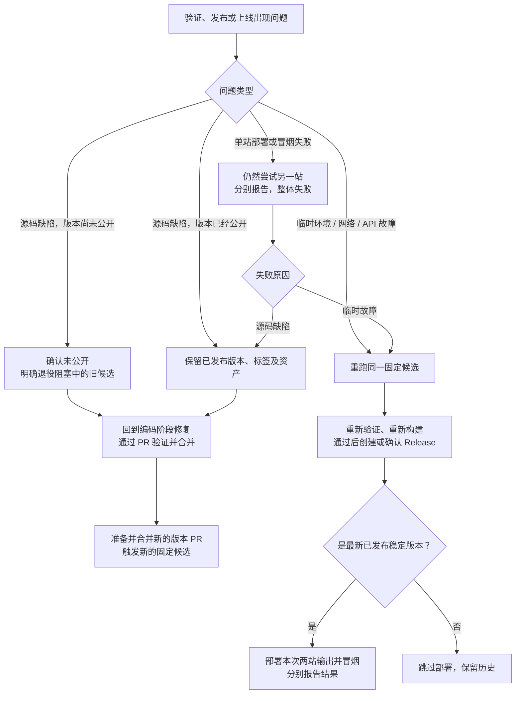

# 质量保证体系重构实施方案

以业务契约清楚、测试简单完整、CI 容易理解为目标，分别落实测试重构与 CI/CD 简化。测试部分保留独立的契约、文件范围、实施步骤和验收条件；CI/CD 部分只决定执行及交付机制。测试分组用于组织代码和报告，不自动变成 CI job。当前机制的事实说明见[质量保证说明](quality-assurance.md)。本方案描述重构目标与迁移边界，实际运行方式见质量保证说明。

## 测试重构的目标与契约

测试设计负责回答“什么行为需要证明、如何清楚地证明”；CI/CD 负责决定这些检查如何执行、通过后如何交付。调整 CI/CD 不构成削减业务契约、测试场景或测试重构步骤的理由。下面的测试工作包可在现有 CI 下先实施。

完整性按业务契约审核，不按测试数量或覆盖率百分比判断。每项删除都要说明由哪条保留的断言承担保障，或者该实现为何已经退役。测试期望不得调用生产排序、翻译、分页或链接函数生成。

| 契约               | 主要验证位置                                                  | 必须保留的场景与其他层职责                                                                            |
| ------------------ | ------------------------------------------------------------- | ----------------------------------------------------------------------------------------------------- |
| 公开集合与草稿     | `tests/build/publication.test.ts`                             | 生产各公开输出排除草稿；dev 可见；按发布时间排序；搜索索引另外验证不泄漏草稿                          |
| 标签归组与文章链接 | `tests/unit/posts.test.ts`、`tests/build/publication.test.ts` | 大小写/空白归一化、非 ASCII 标签、同义标签归组、文章 ID 保留；浏览器保留文章→标签→列表链路            |
| 分页               | `tests/build/pagination.test.ts`                              | 保留 1/10/11/20/21 篇边界、精确每页内容、页数、相邻链接、链接同源；i18n 只补代表性跨页切换            |
| 内容 schema        | `tests/build/schema.test.ts`                                  | 日期、语言、摘要长度、heroAlt、默认值；非法输入命中对应字段，并有修正后的合法控制                     |
| 界面语言与原文     | `tests/unit/i18n.test.ts`、`tests/build/i18n.test.ts`         | URL 决定 UI；原文及内容语言保持；页面身份不变；字典键、空白值、占位符及 fallback                      |
| 日期               | `tests/unit/dates.test.ts`                                    | UTC 输出、语言格式、跨年边界；UTC/Los Angeles/Singapore 独立进程运行                                  |
| SEO 与订阅输出     | `tests/build/seo.test.ts`                                     | canonical/hreflang、OG、JSON-LD、RSS、sitemap、robots；Contact 与共享原文的不同策略；脚本结束标记转义 |
| 部署路径与路由     | `tests/build/base-path.test.ts`、`routes.test.ts`             | 根与子路径、资源前缀、旧路由无重定向 404；保留跨层接线，不重复整套 SEO 规则                           |
| 搜索索引           | `tests/build/search.test.ts`                                  | 真实 Pagefind 中英文查询、公开原文去重、metadata、部署前缀和资源服务                                  |
| 搜索交互           | `tests/e2e/deterministic/default/search.e2e.ts`               | 查询与语言、空查询/无结果、追加结果、旧查询失效、摘要安全、索引不可用、窄屏表现                       |
| 内容渲染           | `tests/build/{rendering,page-math}.test.ts`                   | Markdown/MDX 数学、错误公式、按需样式、表格、复选框、共享页面与嵌入区块                               |
| 主题与可访问交互   | `tests/e2e/deterministic/default/`                            | 显式主题选择与系统偏好、刷新、存储失败、skip link、键盘焦点、360px 布局                               |
| 表单               | `tests/e2e/deterministic/configured-forms/`                   | 必填/email 约束、精确 POST 字段和方法、提交次数、新窗口；默认未配置表单禁用，不真实投递               |
| 浏览器语言切换     | `tests/e2e/deterministic/i18n/navigation.e2e.ts`              | 双向切换、页面/查询/锚点身份、刷新、控件焦点、脚本阻断时的导航与窄屏布局                              |
| 测试工具可靠性     | 隔离、进程退出、输出解析、x18n tooling 与依赖兼容测试         | 保证 fixture 不改真实源码/dist，失败可诊断且能清理；与业务报告区分，不自动新增 CI job                 |

## 测试工作包与依赖

| 工作包                  | 前置   | 交付                                                        |
| ----------------------- | ------ | ----------------------------------------------------------- |
| T0 建立契约基线         | 无     | 现有场景清单、契约映射、删除/迁移的替代证据                 |
| T1 分清测试归属         | T0     | 业务与工具文件分开，schema 场景归位，现有入口仍收集全部用例 |
| T2 拆分大用例           | T1     | 每个测试名称表达一个契约，只读场景共享构建                  |
| T3 删除重复断言         | T2     | 主验证层清楚、跨层接线保留、删减有逐项依据                  |
| T4 简化 fixture         | T2、T3 | 正常构建小接口、异常场景底层接口、源码变异退出日常套件      |
| T5 整理浏览器与视觉测试 | T2、T3 | 确定性行为保留，重复 AI 行为退出，视觉专项仍可运行          |
| T6 补足生产路径连接     | T4、T5 | `/blog/` 下的一条真实 preview 贯通场景                      |

T0–T4 不依赖发布系统重写。T5 的文件删除要与旧 CI 中 AI 调用的移除一起落地，或先保留兼容入口到 CI 切换；不能让仍在运行的 workflow 指向不存在的套件。T6 的本地实现与验证必须在 R3 切换前完成，并随切换接入新 verify；R4 只进行真实发布与线上验收。

### T0 建立业务契约基线

**修改范围：**`tests/TESTING.md`、`tests/I18N.md`、必要的质量说明；不改业务实现。

1. 将契约表对应到现有测试名称，逐项记录拟保留、拆分、迁移、删除的内容。
2. 获取测试文件清单；记录原检查退出状态、耗时和构建次数。报告存放在被忽略的 `tests/test-results/qa-refactor/`，不把运行历史写入项目指南。
3. 对拟删除项说明明确的保留断言，不能只写“其他测试已覆盖”。
4. 区分基线失败、环境缺失与产品行为未定义；不得用删除失败用例使基线变绿。

```sh
mkdir -p tests/test-results/qa-refactor
vp test list --project unit --project build --filesOnly --json tests/test-results/qa-refactor/before.json
```

**验收：**所有调整都有可追溯的契约依据；正常场景、真实失败场景和已知边界分开说明。测试改造不必等待远端发布候选盘点。

### T1 分清归属而不增加执行层

**修改范围：**`tests/unit/`、`tests/build/`、测试指南及引用测试路径的依赖文档。

- 将 `posts.test.ts` 中“stub 拒绝集合访问”的断言移到 `tests/unit/tooling/content-stub.test.ts`，直接验证 stub，不把它描述成文章业务。
- 将 `output-path.test.ts`、`minimatch-security.test.ts` 归入 `tests/unit/tooling/`。
- 将 `isolation.test.ts`、`interruption.test.ts`、`x18n-tooling.test.ts` 归入 `tests/build/tooling/`。
- 将 isolation 中摘要长度及合法控制组移入 `tests/build/schema.test.ts`，保留场景后再清理旧文件。
- 调整移位后的相对 import 和基于 `import.meta.url` 的路径，更新 `tests/I18N.md`、`docs/dependencies.md` 的 focused commands。
- 现有 `tests/unit/**/*.test.ts` 与 `tests/build/**/*.test.ts` 继续覆盖子目录，不新增 Vitest project 或 CI job。日期文件与时区运行器路径保持稳定。
- 当前发布/证据测试先保持可运行；等相应实现退役时一起处理，不为随后要删除的实现先做目录迁移和抽象。

**验收：**前后收集文件一一对应，每个文件只执行一次；场景归位不丢断言；构建类工具测试仍在根 dist 就绪后执行。

### T2 一个测试表达一个业务契约

**修改范围：**`tests/build/{i18n,search,seo,base-path}.test.ts`、`tests/e2e/deterministic/default/search.e2e.ts`。

1. i18n 构建测试按原文保持、页面身份、UI 输出、导航与 SEO 接线拆成具名用例。
2. 搜索构建测试分开索引内容、真实查询、UI metadata、开发服务器资源契约。Pagefind 内部结构检查与读者搜索结果分开标识；不把供应商内部格式当成业务规格。
3. 搜索浏览器大用例拆为追加下一批结果、查询变化使旧分页失效、摘要保留允许标记、慢查询不能覆盖新结果。每个浏览器用例独立起始状态。
4. 同一输入的构建用例用 `beforeAll/afterAll` 共享只读产物；需要改内容或配置时仍使用独立 fixture。
5. 断言失败应输出具体页面、字段或规则。完整用户旅程仍可包含多个断言，不按“一条断言一个 test”机械拆分。

**验收：**失败名称能直接定位业务规则；用例数量增加不导致相同输入被反复构建；不依赖测试执行顺序或共享可变浏览器状态。

### T3 明确主要验证层并删除蕴含性重复

**修改范围：**`tests/build/{pagination,i18n,seo,base-path}.test.ts`、对应 fixtures。

1. 分页保留每页精确内容与实际目录页数、导航和相关 metadata；删除已由这些明确 expected 蕴含的扁平数组、Set 唯一数与页长重复检查。
2. 保留 1/10/11/20/21 场景，以及链接同源检查；仅比较 pathname 不能发现跳到外站的链接。
3. canonical 策略以 SEO 为主，base-path 验证前缀连接，i18n 验证语言与页面身份的接线；不在三处各跑完整策略矩阵。
4. i18n 保留一个代表性的多页场景，分页边界由分页套件承担。
5. 草稿在文章、列表、RSS、搜索等不同输出面的排除继续分别验证；不是看到相同关键词就合并测试。

**验收：**每项删除说明为什么被保留断言蕴含；手写期望仍独立于生产逻辑；没有通过弱化 expected 或只检查“存在”来获得简化。

### T4 收敛 fixture 并验证测试敏感度

**修改范围：**`tests/support/build-fixture.ts`、业务构建测试、工具隔离/中断测试及测试指南。

1. 删除 `invalidDescription` 专用开关，通过已有 `FixturePost.description` 直接表达非法输入。
2. 为正常构建提供有限接口，接收 name、posts、siteUrl，返回产物/报告路径及 dispose；集中处理构建成功、失败诊断和释放。支持多个只读测试共享一次构建，不增加任意 hooks 或测试 DSL。
3. 非法 schema、dev/preview 和进程测试继续使用底层 fixture；业务测试无需理解子进程集合、信号处理和清理注册。
4. 在临时副本分别关闭草稿过滤、破坏 next 链接、将 next/prev 指向外站。先确认构建成功，再确认指定业务断言失败，恢复后同一测试通过。
5. 保存上述验证报告，退出 `mutation` 枚举、精确源码替换分支和四个日常变异探针；不新建常驻 mutation runner，不修改真实工作区来制造故障。
6. 保留隔离、超时、信号退出、失败清理和必要诊断。非法 schema 要命中对应字段，并有修正后的合法控制。

**验收：**fixture 不再认识草稿过滤或分页表达式的具体源码写法；四种目标回归仍能被发现；测试不会改写用户源码与根 dist。

### T5 保留交互契约并收敛 AI 重复

**修改范围：**`tests/e2e/deterministic/`、`tests/e2e/ai/`、`tests/support/{e2e-forms,e2e-reading,run-e2e}.ts`、E2E 配置和指南。

1. 确定性测试继续承担主题状态、导航、语言、搜索、键盘、布局和表单请求契约。存储不可用、索引不可用、旧查询覆盖和重复提交不是无依据的防御测试。
2. 表单使用假凭据和拦截请求，保留方法、字段、请求次数和原生校验；不调用真实第三方服务。
3. AI default 导航/主题/禁用表单和 configured-forms 提交重复场景退出；保留 rendering 的截图可读性检查及内容定位，不能用 DOM 文本代替视觉证据。
4. 将 AI 默认 variant 改为 rendering，明确拒绝不存在的组合；保留模型预算、报告和源码 SHA。按需命令不得指向被删文件。
5. “保留哪些场景”和“CI 选择哪些引擎/视口”分开核对。后文的目标分配是执行策略，不能据此丢掉业务场景；需要额外组合时仍可本地运行。

**验收：**每条删除的 AI 行为都有明确的确定性验证；视觉专项仍能独立执行。没有模型凭据时只报告未执行视觉验收，不冒充通过。

### T6 补足生产子路径贯通与明确覆盖边界

**修改范围：**`tests/support/{run-e2e,e2e-targets,e2e-variants}.ts`、新增 `tests/e2e/deterministic/production-path/navigation.e2e.ts` 及指南。

1. 使用带固定公开文章和唯一搜索词的隔离 fixture，以 `https://fixture.example/blog/` 构建，启动真实 Astro preview，不使用 dev server。
2. manifest 携带一致的 siteUrl，构建与 preview 不得相互覆盖根/子路径配置；同步修改 variant 校验、类型、准备流程和 tests glob，AI 不支持此变体。
3. 一条 desktop 流程串起首页→文章→搜索固定词→中文切换保留查询→中文 UI 的同一篇文章，精确断言路径、结果与页面身份，真实加载 Pagefind。
4. 不覆盖根 dist，不复制整套浏览器矩阵。CLI 命令在该变体实现后才加入指南和新 CI。
5. 空站/全部草稿如何呈现尚需产品契约，不能先写猜测的 expected。历史部署前缀和临时安全 override 未退役前保留对应验证。

**验收：**真实 `/blog/` preview 贯通；根路径不回归；移除资源前缀的临时故障能被发现；没有把本地 preview 成功当作线上托管成功。

## CI/CD 目标与阶段边界

| 阶段           | 职责                                                                 | 交付给下一阶段的内容                  |
| -------------- | -------------------------------------------------------------------- | ------------------------------------- |
| 编码与本地验证 | 实现业务与交互，按 T0–T6 编写、重构和调试测试                        | 可审查的代码、具名业务测试与对应契约  |
| PR CI          | 自动执行已定义的静态检查、业务测试和工具测试，失败则返回编码阶段修复 | 当前待合并源码的验证结果              |
| 发布与部署     | 固定版本与源码，重新验证，构建两种生产输出，公开版本并部署、冒烟     | Release、两站部署及线上冒烟的独立结果 |

交互设计和调试属于编码阶段；CI 执行其确定性回归测试。线上冒烟只验证托管与资源可用性，不重复完整业务交互验收。

已确定：允许发布时针对固定提交重新构建和验证，优先简化整体流程。因此不再以“必须复用 PR 产物”“不能在合并后重跑检查”“保留当前 job 名称”“保留自定义 release manifest”为约束。

推荐采用固定源码、每次发布或部署重试重新验证和构建的交付方式。由此不再保证重试使用先前完全相同的产物字节，也不再默认发布 `pages.tar`、`workers.tar` 和自定义证据 manifest。已发布的历史资产与标签保留。

已确定发布触发方式：合并版本 PR 后自动发布。普通功能或内容 PR 合并不直接触发站点部署；版本 PR 工具继续维护版本与变更说明。临时故障重跑同一固定候选；源码缺陷通过修复后的新版本 PR 产生新候选，未公开旧候选须明确退役，已公开版本保留历史。具体处置见后文“失败恢复规则”，不新增手动选择任意源码发布的入口。

## 从需求决定机制

| 必须满足的结果         | 推荐机制                                                            | 不再沿用的实现前提                                    |
| ---------------------- | ------------------------------------------------------------------- | ----------------------------------------------------- |
| PR 的业务行为可验证    | 一个 CI workflow、一个必需的 verify job，按顺序运行明确步骤         | 每个测试类别独立 job、matrix 后再加聚合门禁           |
| 测试失败能被定位       | 具名业务测试、清楚的 step 名、失败报告                              | 为了报告分组而复制运行环境和传递产物                  |
| 发布来源明确           | 一次固定 version 与 SHA，整次 release run 使用同一提交              | 查询旧 PR run、head、tree、attempt 来关联证据         |
| 发布的是验证过的产物   | 本次发布流程中验证、分别构建两目标、直接部署这些输出                | 下载 PR 归档、自定义 manifest、证据过期及归档解包链   |
| 失败可以恢复           | 临时故障重跑同一 SHA；源码缺陷修复后使用新候选；已存在 tag 必须一致 | 恢复部分上传资产、延迟标签转换、扫描所有 pending 候选 |
| 合并版本 PR 后可靠触发 | 发布队列保留等待任务，并与版本 PR 维护分离                          | 默认单 pending 的并发组、维护任务挤掉发布任务         |
| 两个平台部署结果清楚   | 每个平台明确的部署与冒烟步骤                                        | 从“Release 成功”推断两站已正常上线                    |

这里删除的是机制及其专属测试，不是保留机制却取消测试。草稿泄漏、搜索竞态、URL 正确性、摘要安全、主题及表单等实际业务契约继续保留。

## PR 验证流程

目标是 `.github/workflows/ci.yml` 中只有一个 `verify` job：

```text
检出 PR 的待合并源码
  → 配置固定 Node、pnpm 和浏览器环境，安装一次依赖
  → Astro / Vite+ / ESLint / 翻译检查
  → 纯逻辑、时区及不依赖构建产物的工具测试
  → 构建测试站点
  → 业务构建测试、依赖根 dist 的工具测试、内部链接检查
  → 确定性浏览器测试
  → 保存诊断报告
```

- 必需步骤直接依赖命令退出码，普通失败终止后续验证。不使用测试步骤的 `continue-on-error`，不另写脚本遍历各 step 的 outcome 来重新定义成功。
- 诊断上传可以使用 `always()` 并作为尽力保存的报告步骤；它不能把失败测试变绿，也不承担业务验收职责。
- 根构建产物只在该 job 的工作区使用，不上传后再供其他验证 job 下载。GitHub Pages 部署所需的原生 artifact 属于平台协议，不因此额外发明一套通用归档系统。
- 撤销独立 build-tests、site-audit、quality 聚合及拟新增 delivery-tests/tooling-tests 的设计。删除独立 E2E 工作流的调度职责，将必要浏览器步骤放入 verify。
- 保留 `unit`、`build` 现有测试入口。业务、交付、工具的代码归属可以整理，但先不新增测试项目或 CI job；先删除被退役机制的测试，再看剩余文件是否需要分目录。
- PR title 的轻量检查保持独立，因其还需响应标题编辑；不因改标题重跑完整验证。若要求 Conventional Commit 标题，分支规则同时要求 title 与 verify，这不需要第三个汇总 gate。
- 不新增路径过滤、动态任务选择器、自定义 CI 调度器或大而全的 `qa.ts`。workflow 应当直接读出执行顺序。

一个串行 job 的代价是后续检查需要等待，前面失败后不会继续搜集全部失败，重跑可能重复已成功步骤。这是清晰性与反馈时延的取舍，不预先声称会更快。先记录实际时间；只有反馈时间确实不合适时，再考虑两个独立的 checks/browser job，各自构建、分别设为 required，不恢复 artifact 接力或聚合 gate。

## 浏览器与专项检查的范围

测试用例按业务契约保留。四个现有确定性套件保留 `desktop,narrow,webkit` 全部目标，由[CI 工作流](../.github/workflows/ci.yml)统一执行：`desktop` 为 Chromium 桌面，`narrow` 为 Chromium 360px，`webkit` 为 WebKit 360px。收敛 job 不同时缩减浏览器覆盖；尤其保留 WebKit 下键盘焦点、原生控件及语言菜单的回归验证。

| 套件             | 必需目标                                | 验证目的                                            |
| ---------------- | --------------------------------------- | --------------------------------------------------- |
| default          | Chromium desktop、narrow；WebKit narrow | 主要导航、主题、搜索、键盘与窄屏布局                |
| i18n             | Chromium desktop、narrow；WebKit narrow | 页面身份、语言控件、查询/锚点与布局                 |
| configured-forms | Chromium desktop、narrow；WebKit narrow | 原生校验、POST 和新窗口提交                         |
| rendering        | Chromium desktop、narrow；WebKit narrow | 宽内容滚动与嵌入控件在两种引擎的布局                |
| 生产子路径贯通   | Chromium desktop，一条流程              | `/blog/` 下首页、文章、搜索及语言切换的真实资源连接 |

这些目标在一个 verify job 内通过明确命令执行，不恢复 Actions matrix 或聚合 gate。生产子路径按 T6 增加一条 desktop 贯通流程，不复制全部组合。将来如需删除现有组合，必须先提供该组合契约的替代验证依据，不能仅以减少 CI 任务为理由。

- AI 导航、主题、表单的重复场景退出必需回归；复杂渲染的视觉检查保留为按需命令。先不为它新增一个 CI 工作流。
- Lighthouse 作为性能/可访问性专项保留工具与配置，不默认让四项总分 95 成为每次业务 PR 的硬门槛。关键键盘、焦点、布局与 SEO 契约继续由确定性测试承担。
- 视觉或性能相关改动应记录对应专项结果和源码 SHA。手动没有执行，不等于通过；如果以后确实需要远端专项入口，再增加明确用途的 workflow。
- 内部链接检查继续跟随产物验证，不需要独立 job。

## 固定提交的发布流程

版本 PR 工具负责准备版本号和变更说明。公开发布发生在验证之后，不使用“先公开 Release，再构建”的顺序。



### 必要约束

1. 只接受合并到 main 的同仓库版本 PR，候选完整 SHA 来自该次合并事件，版本来自该提交的版本文件。重试沿用同一候选；后续步骤不得重新读取移动中的 main 作为构建来源。
2. 核心验证与 PR 使用同一组有明确职责的命令；workflow 可以重复少量命令行，不为消除 YAML 重复而新增调度框架。生产目标相关的路径、SEO、搜索资源检查必须针对各自产物执行。
3. 两个目标 URL 不同，必须分别构建。在构建 Workers 前保存 Pages 输出到独立目录，禁止部署时误用后来覆盖的 dist。
4. 所有验证及两种生产构建成功后才创建公开 Release。已有相同 tag 必须指向同一 SHA；不同 SHA 直接失败，不能移动 tag、替换历史资产或自动删除 Release。
5. 部署或冒烟因临时故障失败时，重试同一固定提交的验证和构建，再继续部署；源码缺陷按后文规则产生新候选。不存在“校验本次新产物却部署旧缓存”的路径。每次部署前只允许最新已发布稳定版本，旧候选跳过部署并明确报告，防止旧重试覆盖新版本；不增加两平台的版本登记系统。
6. 一个托管目标失败不妨碍尝试另一个：在 workflow 中使用明确的部署步骤条件，两个结果分别显示；任一失败，整体运行失败。无需再写通用状态汇总器。
7. Release 与部署使用同一独立并发组，覆盖整个发布与部署过程；配置 `queue: max` 和 `cancel-in-progress: false`。版本 PR 维护任务不共用此组，不能挤掉等待中的发布任务。恢复使用明确的原 run/候选或修复后的新版本 PR，不监听其他 workflow 完成来反复扫描历史候选。
8. 写凭据只提供给发布、部署步骤，验证步骤不需要发布权限。产物只在本次 run 内从验证流向部署；失败诊断可保存，但不参与下一次发布批准。

### 发布队列

发布与部署工作流使用以下并发配置，版本 PR 维护使用独立并发组：

```yaml
concurrency:
  group: release-main
  queue: max
  cancel-in-progress: false
```

`cancel-in-progress: false` 仅保护运行中的任务；默认 `queue: single` 仍会让新任务替换旧 pending。`queue: max` 最多保留 100 个等待任务，满队列后的新增任务会被取消，不能视为成功。队列顺序依据开始等待的时间，不能代替部署前的最新稳定版本检查。[依据：GitHub Actions 并发规则](https://docs.github.com/en/actions/how-tos/write-workflows/choose-when-workflows-run/control-workflow-concurrency)

### 失败恢复规则

先区分临时故障与源码缺陷，再确认版本是否已经公开。重跑固定 SHA 不会包含后来合入的源码修复。

| 情况                       | 恢复动作                                                                       | 必须保持的结果                                                    |
| -------------------------- | ------------------------------------------------------------------------------ | ----------------------------------------------------------------- |
| 环境、网络或 API 临时故障  | 重跑原 run 的同一 version/SHA，重新验证并构建，再继续发布或部署                | 不改读 main；已有相同 tag 仅在 SHA 一致时复用                     |
| 源码缺陷，候选尚未公开     | 确认未公开并明确退役旧候选；修复通过 PR 验证后合入；准备并合并新的版本 PR      | 新候选包含修复；旧 pending 不再阻塞下一版本；允许跳过未公开版本号 |
| 源码缺陷，版本已经公开     | 保留已发布版本，修复通过 PR 验证后合入，以后续版本 PR 发布                     | 不移动历史 tag，不重写已发布 Release 或资产                       |
| 单站部署或冒烟失败         | 仍尝试另一站，分别报告且整体失败；临时故障重跑同一候选，源码问题按上述分支处理 | 每次重跑重新验证、构建；只部署本次正确输出                        |
| 重试的版本已不是最新稳定版 | 跳过部署并报告已被后续版本取代                                                 | 旧 run 不能覆盖新版本；跳过不表示本站已上线该旧版本               |
| 已有 tag 指向不同 SHA      | 终止并核对冲突                                                                 | 不强推或移动 tag，不通过重跑绕过冲突                              |

未公开候选的退役是针对具体候选的明确操作。沿用 Release Please 时，确认尚未公开后移除该已合并版本 PR 的 `autorelease: pending` 阻塞标记；不得批量清理 pending、自动删除 draft 或改动 tag。现行工具也需要这一步才能准备下一版本，见[发布指南中的源码修复恢复](releasing.md#inspect-and-retry)。这项恢复规则持续适用，不仅用于切换旧流程。



### 最小发布实现的范围

优先使用现有版本 PR 工具和 GitHub/部署工具完成普通操作。工具如何区分维护版本 PR 与公开 Release，在实施时按当前官方接口核对；不能为了少写代码牺牲“验证后发布”的顺序。

自定义逻辑只保留固定候选、版本与 tag 一致性、重复执行、两目标输出选择等真正需要的规则。测试围绕这些结果写正反例，不再模拟已删除的 PR artifact 协调过程。

部署后冒烟只做少量 GET：关键页面、搜索 JS、一个不存在地址。分别验证状态、避免 HTML fallback 冒充 JS，并允许有总时限的传播重试。不加入真实表单投递、自动回滚、跨工作流脚本搬运或历史归档恢复机制。部署与 smoke 在同一发布流程的固定源码上执行；旧流程的未完成版本在切换时单独处理。

## 明确退役的机制

| 当前或上一版拟保留的机制                                          | 本方案处理                                                           |
| ----------------------------------------------------------------- | -------------------------------------------------------------------- |
| PR CI 内的 release-builds 特例                                    | 移到固定 SHA 的发布流程，普通 PR 与版本 PR 不再有两种 CI 成功定义    |
| `quality` 自定义聚合、`verify-e2e-job.ts`                         | 退役，由单一 verify job 的实际步骤结果决定                           |
| 新增 `verify-ci-job.ts` 和用于测试它的 YAML 解析依赖              | 不实施；没有必要为即将删除的 gate 建新 module                        |
| `release-evidence.ts`、PR run/head/tree/attempt/artifact 匹配     | 退役，不迁移成另一套证据协议                                         |
| `release-artifacts.ts` 中的证据下载、公共归档与 manifest 生命周期 | 随自定义 Release assets 退役；实际仍使用的普通发布操作按最小需要替换 |
| `deploy-release.ts` 的归档下载/摘要/安全解包链                    | 不再消费这些归档后，连实现和专属测试一起退役                         |
| Release workflow 的 `workflow_run` 唤醒                           | 删除；发布不等待其他 workflow 的旧产物                               |
| 为上述机制存在的状态机、HTTP mock、源码表达式断言                 | 随机制删除；不先搬迁、抽象或重写整套测试                             |
| 每个测试责任一个 job                                              | 取消；用具名 step 和测试报告区分                                     |
| 常驻源码变异                                                      | 在临时副本完成敏感度验证后退出日常套件                               |

已发布 Release 的资产、标签和历史记录不在删除范围。`check-closeout.ts` 的工作区/PR 状态核验可以保留，但应更新它对旧证据链的提示，不让交付指南继续要求已经退役的 manifest。

## 测试与 CI/CD 的集成顺序

| 工作包                | 文件范围与具体动作                                                                                                                                         | 验收与前置                                                                                         |
| --------------------- | ---------------------------------------------------------------------------------------------------------------------------------------------------------- | -------------------------------------------------------------------------------------------------- |
| R0 确定迁移边界       | 核对 requirements、当前 required checks、版本 PR、pending 候选、draft Release、已发布 tag 与部署结果；更新测试契约表                                       | 无代码删除。已知旧候选有明确完成/保留/退役处置；无法读取远端状态时不能声明可以安全切换             |
| R1 整理业务测试       | `tests/build/`、`tests/unit/`、`tests/e2e/`、`tests/support/`；拆大用例、删蕴含性重复、简化 fixture，完成 T6 本地生产路径贯通，保持现有 CI 可运行          | 细分步骤见 T0–T6；业务部分不等待远端发布盘点。删除项有保留证据，T6 本地验证通过                    |
| R2 准备最小发布路径   | 替换 `scripts/release.ts` 中证据协调职责；准备固定 SHA 验证、两目标构建、独立发布队列、分类恢复及两站 GET smoke 的代码和接线；新测试只覆盖这些规则         | 不与旧自动发布同时启用。通过下列发布恢复验收，包括 smoke 成功与失败处理；核对当前发布工具接口      |
| R3 一次切换 CI 与发布 | `ci.yml` 收敛成 verify，保留四套浏览器目标并接入 T6；启用含两站 smoke 的新 release/deploy；退役旧 E2E 调度、跨 workflow 证据及专属 scripts/tests；更新指南 | 依赖 R0 迁移边界确认、R1 与 R2 验证通过。新 CI 与新发布消费者同一 PR 交付，切换时两站 smoke 已接入 |
| R4 完成真实发布验收   | 合并版本 PR，观察自动发布、两站部署及已经接入的线上 GET smoke，分别记录结果                                                                                | 依赖 R3。本地通过不代替线上通过；未执行真实发布时，线上验收保持待完成                              |

不再先做“新增 delivery/tooling job”“重构旧 gate”“维护旧 manifest”这些随后又要删除的工作。R1 不必等待所有发布细节；R3 必须等 T6 本地验证通过、R2 的发布路径与两站 smoke 准备完成。生产路径贯通测试和冒烟实现都在启用新流程前完成，切换后只进行真实发布验收，不再补齐这些必要检查。

R2/R3 的发布恢复验收围绕可观察结果，不重新建立旧证据链的模拟：

1. 验证或任一生产构建失败时不公开 Release；临时故障重跑仍使用原 version/SHA，相同 tag 可复用，冲突 tag 阻断。
2. 未公开候选因源码缺陷失败后，明确退役并合入修复，版本工具能够准备包含修复的新版本 PR，不被旧 pending 阻塞。
3. 已公开版本的源码缺陷通过后续版本修复，原 tag、Release 和资产保持不变。
4. Pages 与 Workers 分别模拟部署或冒烟失败；另一站仍会尝试，失败状态不被吞掉；重跑部署使用新验证的各自输出。
5. A 正在发布、B 等待、C 到达及版本 PR 维护触发时，B 不被替换；旧候选晚执行或重试时不能覆盖最新稳定版本。
6. 四套确定性测试的 `desktop,narrow,webkit` 目标及 T6 生产路径贯通全部进入新 verify，并在切换前通过；本地根路径验证后恢复默认生产构建。

### 切换前的一次性处理

- T6 本地贯通测试和新 verify 接线已验证；两站 GET smoke 已实现、接入新发布流程，成功与失败处理均已验证，才可启用新自动发布。
- 有尚未完成的旧发布时，先用旧流程完成，或明确决定退役未公开候选。不得自动清 pending、删 draft、移动 tag 或重写资产。
- 没有旧状态需要处理时，直接切换，不为假想历史状态保留永久兼容层。
- 新 verify 在最新 PR head 成功后，再将分支规则从旧 CI/E2E 检查改为 verify，并保留需要的 title 要求。旧检查名称不是架构约束，但不能留下永远等待旧 workflow 的规则。
- 旧自动发布与新自动发布只能有一个拥有创建版本及部署的职责。切换 PR 不自动授权发布或修改远端规则；这些操作按实际实施任务授权执行。

## 分支与 PR 实施顺序

每个可独立验收的批次使用一条短期分支、一个 PR，目标分支统一为 `main`。前一批合并并完成收尾核验后，从同步后的 `main` 创建下一条分支；按下表逐批创建。

| 顺序 | 分支名                        | 工作范围                                                           | 合并条件                                                                   |
| ---- | ----------------------------- | ------------------------------------------------------------------ | -------------------------------------------------------------------------- |
| 1    | `refactor/qa-t0-t1`           | T0 契约映射、T1 测试归属整理，以及质量保证说明与重构方案           | 基线可追溯；迁移后收集完整；相关测试通过；现有 CI 继续运行                 |
| 2    | `refactor/qa-t2-t3`           | 拆分大用例、明确主要验证层、删除有替代保障的重复断言               | 每项删减都有具体依据；业务契约和边界场景保留                               |
| 3    | `refactor/qa-t4-fixtures`     | 简化 fixture，验证测试敏感度，退出日常源码变异探针                 | 隔离、清理和诊断有效；临时注入的目标回归仍能被发现                         |
| 4    | `refactor/qa-t5-t6-browser`   | 整理确定性与视觉测试职责，补生产 `/blog/` 路径贯通                 | 四套浏览器目标保留；T6 本地通过；旧 CI 调用仍然有效                        |
| 5    | `refactor/qa-release-prepare` | R2：准备固定源码发布、双目标构建、分类恢复、队列和两站冒烟         | 新路径及失败处理验证通过；旧发布入口保持有效；尚未启用新自动发布           |
| 6    | `refactor/qa-cicd-cutover`    | R3：切换 verify 和发布流程，退役旧证据链、专属脚本与测试，更新指南 | 重新核对 R0 状态；前置测试与冒烟准备完成；新检查通过后协调 required checks |

R0 是并行只读盘点，不单独创建实现分支；盘点结果按 T0 的报告约定保存，切换前重新核对远端状态。R4 使用版本工具维护的版本 PR 完成真实发布验收，不另建 QA 实现分支。

### 第一条分支

从承载第一批工作的当前 `HEAD` 创建分支。若 T0/T1 改动已在 `main` 工作区中且尚未提交，以下命令会保留已有修改及未跟踪文件：

```sh
git status --short --branch
git switch -c refactor/qa-t0-t1
```

在这条分支内审查并提交该批次文件，保留无关改动。质量保证说明和重构方案随第一批纳入版本管理；被忽略的 `tests/test-results/qa-refactor/` 运行报告继续保存在报告目录，不强制加入 Git。

### 后续分支

前一批 PR 合并并完成[收尾核验](agents/closeout.md)后，确认工作区干净，再同步 `main`。以下以第二条分支为例；先检查 fetch 带来的提交，再快进同步：

```sh
git fetch origin
git log --oneline main..origin/main
git switch main
git merge --ff-only origin/main
git switch -c refactor/qa-t2-t3
```

后续批次采用同样流程，将最后一条命令替换为表中的下一分支名。工作区存在未处理改动或分支分叉时，先核对并保留工作，不用 reset、自动 stash 或强推绕过问题。各批次分别执行基础检查和受影响的测试，合并与分支清理遵循收尾指南。

### 跨分支的切换边界

- 第四条分支先完成测试整理、视觉专项入口和 T6。仍被旧 workflow 调用的 AI 套件或入口必须保持可运行；相关文件的实际删除与旧调用的移除在第六条切换分支一起完成。T6 的准备不等待这项删除。
- 第五条分支准备并验证新实现，旧发布入口继续有效，不提前启用新自动触发，也不破坏旧路径仍使用的函数或脚本。
- 第六条分支统一切换证据生产者、发布消费者及自动触发，旧机制的实现、专属测试和引用一起退役。切换前必须满足前文的 T6、两站冒烟及发布恢复验收条件。
- 分支创建和实现 PR 的合并，不自动授权合并版本 PR、发布、部署或修改远端规则；这些操作按实际任务授权执行。

## 验证与完成标准

基础检查继续执行：

```sh
vp run check && vp check && vp run lint && vp run build
```

业务验证使用现有入口，生产构建与根路径浏览器基线必须显式使用一致的 SITE_URL：

```sh
pnpm run i18n:check
pnpm run test:unit
pnpm run test:unit:tz
env -u SITE_URL vp run build
env -u SITE_URL pnpm run test:build
SITE_URL=https://sionrbot.github.io vp run build
SITE_URL=https://sionrbot.github.io pnpm run test:e2e -- --variant default --target desktop,narrow,webkit
SITE_URL=https://sionrbot.github.io pnpm run test:e2e -- --variant i18n --target desktop,narrow,webkit
SITE_URL=https://sionrbot.github.io pnpm run test:e2e -- --variant configured-forms --target desktop,narrow,webkit
SITE_URL=https://sionrbot.github.io pnpm run test:e2e -- --variant rendering --target desktop,narrow,webkit
env -u SITE_URL vp run build
```

上述命令为本地分组验证，最后一条将根 dist 恢复为默认生产 `/blog/` 构建；即使浏览器验证失败，也须完成恢复，避免后续默认 `test:build` 误读根路径产物。新 verify job 固定统一的测试 URL，在工作区内复用相同基线产物，不需要为不同 job 重建或传递。具有不同配置的 fixture 仍按测试需要独立构建。实施后同步更新命令入口，不留下指向被删除套件的 AI 默认值或脚本。

完成标准：

1. 普通 PR 从一个 verify job 即可理解验证过程，没有聚合脚本、动态矩阵或必需检查的 artifact 接力。
2. 重要业务契约仍有主要验证位置；移除某机制时，其实现、专属测试、workflow 引用和文档一起退役。
3. 发布候选的 version/SHA 一次固定；验证失败不能公开发布；两站使用各自正确输出；重试不改写历史版本。
   临时故障与源码缺陷按不同恢复路径处理；未公开旧候选可明确退役并产生包含修复的新候选；部署前检查最新稳定版本。
4. 记录改造前后的验证时间和失败位置，不用减少 YAML 行数或增加测试数量冒充质量提升。
5. 项目指南只记录最终运行方式；测试结果保存在日志和报告。PR 检查、Release、两站部署和线上 smoke 分别报告。
6. 每个工作包能独立验证；CI/CD 切换整体回退，不恢复生产者却遗漏消费者，或反过来。已发布历史保持不变。
7. 发布队列保留等待任务并与版本 PR 维护分离；单站失败仍尝试另一站，整体失败且各站结果可区分。
